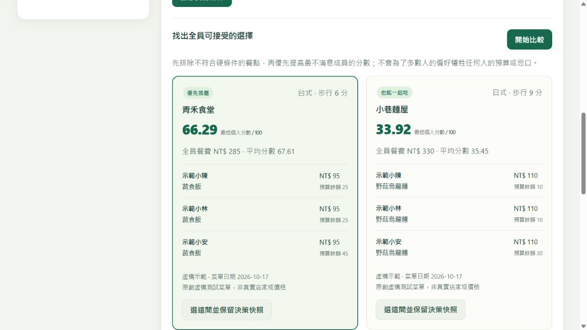

# MealBridge · 一起吃，不必將就

> A constraint-first group meal decision room, with explainable fairness and versioned menu evidence.

為「幾位同學想一起吃午餐，但有人吃素、有人預算有限」設計的手機優先網頁 App。不是另一個餐廳星等排行榜：先確定**同一間店有每個人都能接受的實際餐點**，再比較選擇。

這是全新、AI 協作開發的作品集初版，不是舊課程專案原始碼的還原；未有真實使用者研究或營運成效。所有內建店家、價格、步行時間均為原創虛構示範。



## 為什麼值得做

搜尋餐廳容易，協調每位同行者的限制不容易。單一預算標籤或平均分數會掩蓋少數人的不可接受選項。本案以共享決策室收集條件，明確回覆「能一起吃什麼」及「哪些店為什麼不行」。

適合小群體已有候選菜單、需要一起決定；若要探索大量真實餐廳、訂位或導航，既有服務更完整。競品與開源調查、差異的證據及限制見 [PRODUCT.md](PRODUCT.md)。

## 已完成

- 帳號註冊、登入、登出，8 小時 HttpOnly 工作階段；隱私決策室及不可猜測邀請碼。
- 每人餐費上限、蛋奶素、不吃牛／豬／辣、步行上限；未知成分在相關限制下不視為安全符合。
- 菜單超過 30 天或日期在未來則排除；每位成員都須填妥才能比較。
- 硬條件過濾後，以最低個人分數優先、平均分數次之排序；逐人餐點、餘額及排除理由可解釋。
- 主辦人定案時同時檢查決策室與菜單版本，避免用舊結果定案；保存不可變更決策快照，可下載 JSON。
- 維護金鑰保護的菜單整批驗證匯入；登入成員可回報錯誤，回報不會自動竄改菜單。
- 響應式介面、PWA manifest、192/512 圖示及只快取公開介面的 service worker；離線不假裝送出操作。

## 本機啟動

Python 3.11–3.13。無需 Node、付費金鑰或外部資料庫即可啟動。

```powershell
python -m venv .venv
.venv\Scripts\python -m pip install -r requirements.lock.txt
.venv\Scripts\python seed.py
.venv\Scripts\python -m uvicorn app:app --host 127.0.0.1 --port 8000
```

macOS / Linux 將 `.venv\Scripts\python` 改為 `.venv/bin/python`。開啟 <http://127.0.0.1:8000>，自行註冊示範用帳號，不要重用真實密碼。API 文件：`/docs`。

`seed.py` 只匯入五間虛構餐廳，不會建立預設管理員或密碼；已有菜單時拒絕覆蓋，明確加 `--replace` 才取代。查核日期是測試基準，不是實地驗證。

環境變數（由系統設定，程式不自動載入 `.env`）：

| 名稱 | 用途 |
|---|---|
| `MEALBRIDGE_DB` | SQLite 檔案路徑，預設 `data/mealbridge.db` |
| `CATALOG_KEY` | 選用，菜單維護金鑰；未設定則遠端匯入停用 |
| `COOKIE_SECURE` | HTTPS 服務設為 `1`；本機 HTTP 保持 `0` |

正式菜單須自行取得合法資料、人工查核飲食分類及標明來源，再使用 `/api/catalog` 置換。沒有爬取未授權網站、沒有真實店家整合。

## 三分鐘展示

1. A、B 使用不同瀏覽器工作階段登入；A 建立「週五午餐」並分享邀請。
2. A 設 NT$140、台式；B 加入並設 NT$120、蛋奶素、不吃辣。
3. 比較：青禾食堂與小巷麵屋可行；辣日沒有 B 可吃的餐點，昨日小館資料過期，未明料理資訊不足。
4. 先比較、再修改一人的偏好；舊版本定案會被 API 拒絕，重新比較才能定案。
5. 主辦人選定並匯出快照。菜單日後改價，不會改寫這次的決策紀錄。

## 驗證

```powershell
.venv\Scripts\python -m pip install -r requirements-dev.lock.txt
.venv\Scripts\python -m pytest -q
node --check app.js
node --test test_browser.mjs
```

Node 22+ 僅用於前端／PWA 測試。初版驗證項目：**37 項 Python 測試、5 項 PWA 測試**；涵蓋隱私授權、快照不可變、舊版本衝突、預算與飲食硬限制、未知資訊、查核日期邊界、匯入原子性及工作階段安全。CI 設定 Windows / Ubuntu × Python 3.11 / 3.12 / 3.13；實際執行結果以 [Actions](https://github.com/Ct2510/MealBridge/actions) 為準。

## 架構與邊界

FastAPI + Pydantic + SQLite + 原生 JavaScript / CSS。刻意不加入不必要的前端建置鏈，保留可讀的決策演算法與完整交易。詳見 [ARCHITECTURE.md](ARCHITECTURE.md)、[API.md](API.md)。

PWA 可安裝性取決於 HTTPS、瀏覽器及平台；iPhone 通常由分享選單加入主畫面。只有介面可離線，個人偏好、登入回應與決策 API 不會快取。未提供背景同步或推播。

這不是訂位、支付、導航、過敏原檢測或醫療飲食工具。蛋奶素不等於全素，肉類清單不等於完整成分表。正式對外服務前仍須補齊資料查核流程、帳號復原／刪除、監控、備份還原演練、負載與資安審查。附 Dockerfile，但本機未驗證容器建置。

## 原創與授權

競品／開源僅作問題與功能比較，沒有複製其程式、圖像或資料集；參考清單與已查核授權範圍在 PRODUCT.md。公開 Repository 不等於授予任意再利用權；本案尚未另選開源授權。第三方 Python 套件依各自授權使用。
